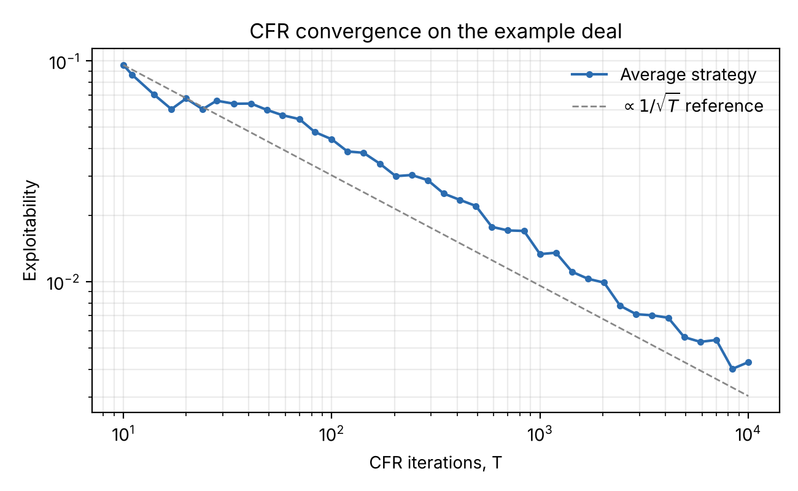

# Card-Jitsu Solver

A Python solver for Card-Jitsu, the simultaneous-move card game from Club Penguin, modelled as a two-player game of imperfect information. The project contains two AI players:

- **an exploitative bot** that models its opponent with Bayesian inference and plays to beat them, and
- **an equilibrium (GTO) bot** that uses counterfactual regret minimisation (CFR) to approximate a Nash equilibrium strategy that cannot be exploited.

The game is a useful test case because it extends rock-paper-scissors with depleting hands, card values, colour-based win conditions and "power cards" that change the rules mid-round.

## The game model

Each round, both players choose a card simultaneously. Cards have an element (fire, water or snow), a value and a colour. Element beats element as in rock-paper-scissors, and value breaks ties. A player wins by collecting either three cards of the same element in different colours, or one card of each element in different colours.

Power cards modify the payoff of a round or of future rounds:

| Effect | How it is modelled |
|---|---|
| Element change (e.g. fire becomes snow) | Converts that element before the round is resolved |
| `LOW_WINS` | Reverses the value comparison for that round |
| `+2` / `−2` | Adds 2 to your value, or subtracts 2 from the opponent's, on the next turn |
| Element block | Sets the probability of playing the blocked element to zero on the next turn |
| Discard / deck effects | Removes cards from a player's collected tableau, reducing their progress |

## 1. Exploitative bot (Bayesian opponent modelling)

Designed for play against humans.

- **Level-k opponent model.** The bot keeps a belief over the opponent's reasoning level (random, self-focused or defensive) and updates it with Bayes' theorem after every round.
- **Card evaluation.** For each candidate card, it counts the cards that would complete a winning set ("outs") in the next draw and, discounted, in the following one.
- **Expected value with lookahead.** It weights each possible outcome, including power-card effects, by the predicted probability of the opponent's choice, and plays the card with the highest expected value.

## 2. Equilibrium bot (counterfactual regret minimisation)

Designed to be unexploitable.

- The bot repeatedly plays against itself. After each iteration, it computes the **regret** of every card, defined as the value that card would have earned minus the value of the strategy actually played.
- **Regret matching** sets the next strategy in proportion to positive accumulated regret.
- The **average strategy** over all iterations converges towards a Nash equilibrium, at which neither player can gain by changing their mix.

### Example

Player 1 holds `10 FIRE [LOW_WINS]`, `4 WATER` and `7 SNOW`. Player 2 holds `3 FIRE`, `11 WATER` and `12 SNOW`. After 10,000 CFR iterations:

```text
--- PLAYER 1 GTO STRATEGY ---
> 10 FIRE RED [LOW_WINS]: 33.21%
> 4 WATER BLUE: 33.83%
> 7 SNOW GREEN: 32.96%

--- PLAYER 2 GTO STRATEGY ---
> 3 FIRE YELLOW: 33.82%
> 11 WATER ORANGE: 33.58%
> 12 SNOW PURPLE: 32.60%
```

Because element decides most rounds and card value only breaks ties between cards of the same element, the equilibrium here stays close to the uniform rock-paper-scissors mix of one third each. The value and `LOW_WINS` effects shift it only slightly, and the solver recovers this without any of it being hard-coded.

### Convergence



Exploitability measures how much a best-responding opponent could win against the bot's average strategy, and it is zero at a Nash equilibrium. On the example deal it falls from about 0.10 after 10 iterations to 0.004 after 10,000, close to the 1/√T rate expected for CFR. This confirms that the near-uniform result is a converged equilibrium rather than the uniform starting strategy.

## Running it

Requires Python 3.9+. The convergence plot also needs NumPy and Matplotlib.

```bash
python card_jitsu_solver.py                      # train the CFR bot on the example deal
python card_jitsu_solver.py --iterations 50000   # train for longer
python card_jitsu_solver.py --play               # live game: enter your hand and each round's cards, get a recommended play
python plot_convergence.py                       # regenerate convergence.png
```

## Limitations

- **The CFR bot solves one fixed deal.** Both hands are fixed and there are no redraws, so the tree is three rounds deep. Unfinished games are scored with the same heuristic board evaluation the exploitative bot uses, not played out to the end.
- **Element blocks are not enforced in the CFR tree.** They are recorded in the information set, but the blocked player can still choose the blocked element. The exploitative bot does enforce them.
- **The exploitative bot uses hand-tuned heuristics.** These are the level-k prior, the 0.25 discount on second-draw outs, the 0.95 equity cap and the +0.2 bonus for block cards. It also predicts only the opponent's element, and treats value and colour as drawn from the remaining deck.

## Background

Built as a personal project to learn game theory and Bayesian inference in Python, alongside an MEng in Aeronautics with Spacecraft Engineering at Imperial College London.
